<p align="center">
  <b>English</b> · <a href="README.pt-BR.md">Português</a>
</p>

<p align="center">
  
</p>

<h1 align="center">Playtrove</h1>

<p align="center">
  <strong>All your PC games in one library.</strong><br>
  A game library manager for Windows, inspired by Playnite.
</p>

<p align="center">
  
  
  
  <a href="https://github.com/LamarcKz/Playtrove/actions/workflows/tests.yml"></a>
  
  
  
  
  
</p>

<p align="center">
  <a href="https://lamarckz.github.io/Playtrove-site/en/">Website and guides</a> ·
  <a href="#about">About</a> ·
  <a href="#features">Features</a> ·
  <a href="#screenshots">Screenshots</a> ·
  <a href="#download">Download</a> ·
  <a href="#build-from-source">Build from source</a> ·
  <a href="#roadmap">Roadmap</a>
</p>

<p align="center">
  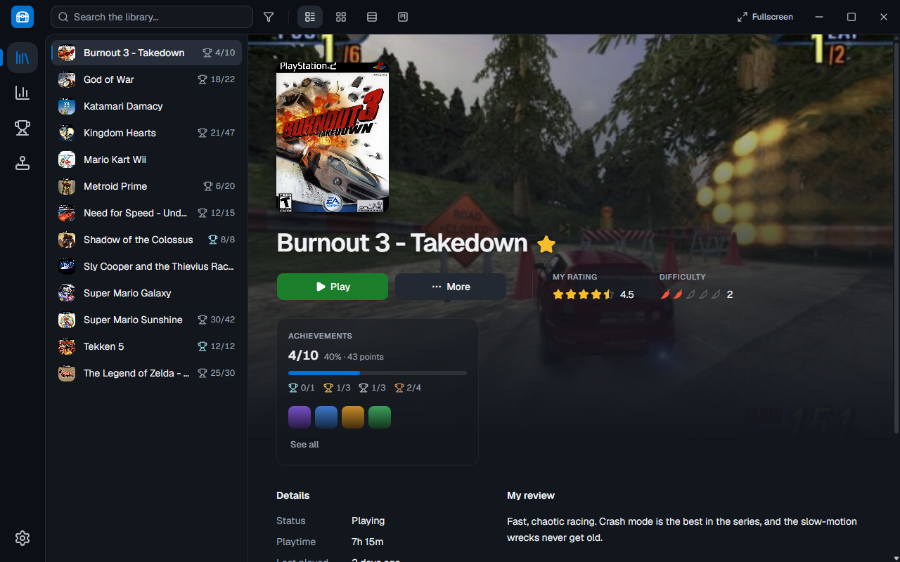
</p>

## About

PC gamers end up with their games scattered everywhere: some on Steam, some on GOG, a few in emulators and others installed in random folders, each with its own launcher. **Playtrove** brings them together in one place, with cover art, details and playtime, ready to launch with one click.

The desktop look follows [Playnite](https://playnite.link/): a dark frame with the tools at the top, an icon menu on the left and your library in the middle. A fullscreen presentation adds a horizontal cover library and Signature game details. Your library is stored on your own computer, in a local database, with no account and no internet required.

> [!NOTE]
> Playtrove is still being built. For now, games come in through emulators (PCSX2, DuckStation, RetroArch, RPCS3, PPSSPP, Dolphin and Azahar); Steam, GOG and other stores are on the [roadmap](#roadmap).

## Features

- **Emulators**: Playtrove finds PCSX2, DuckStation, RetroArch (with its installed cores), RPCS3, PPSSPP (PSP), Dolphin (GameCube and Wii) and Azahar (3DS) on its own. Point it to your ROM folders: the emulator, core and console are suggested from the folder name, and games are added with clean names, without "(USA)" and the like.
- **Play**: opens the game in its emulator, with the emulator's own settings (RetroArch opens maximized in a window, unless it is set to fullscreen), and keeps track of playtime and when you last played. Time recorded by the emulators themselves counts too, so games you started straight from the emulator show up the same way.
- **Metadata and images**: as in Playnite, covers come first from [SteamGridDB](https://www.steamgriddb.com/) (upright covers that fit the frame), which also provides the background art, then from IGDB and, as a last resort, from [libretro-thumbnails](https://thumbnails.libretro.com/) (the box scans RetroArch uses, no key needed); description, genres, developer, publisher and release date come from [IGDB](https://www.igdb.com/). Both keys are free, and the app explains how to get each one.
- **Details view**: the main library view. Your games are listed on the left, with icons. On the right: the background art, the cover above the title, the **Play** and **More** buttons, the details and the description.
- **Fullscreen**: four themes. The default Playtrove theme is inspired by Playnite's own fullscreen mode, and three more take their style from game consoles, each with its own home screen, game details, colors and navigation sounds: Horizon (a row of games on top and the art filling the screen), Mosaic (big square covers and round shortcuts, in dark gray and red) and Panel (art in the background and big tiles: continue playing, collections, achievements and statistics). Switch themes from **Settings → General** or the fullscreen main menu. All of them have game details, collections, search, the same filters as the desktop library plus sorting, a main menu with power options (lock, sleep, restart and shut down, each with a confirmation), session notifications, a help screen, navigation sounds made by the app and an option to swap ✕ and ○, alongside reviews and achievements; the Playtrove theme shows one to three rows of covers. Navigate with a DualSense over USB or Bluetooth, a keyboard or a mouse; physical controller validation is still pending. **Settings → General** and the fullscreen settings offer optional fullscreen startup and separate music playback/volume controls; trailers play silently in game details and, optionally, behind the library. Media and controller navigation pause while the window is inactive or a game is running. Emulator and ROM-folder setup remains in the desktop interface.
- **Grid view**: every cover in the same upright 3:4 frame, filling it, so the grid lines up. The grid adapts to the window, with the status on a strip below each cover and a details panel when you click a game.
- **Matching covers**: Grid, Details, the side panel and fullscreen all use the same 3:4 frame, with the art filling it (covers of other shapes lose a little of their edges, with no stretching or blurred filler).
- **Background trailers and videos**: with IGDB configured, Playtrove downloads a YouTube trailer alongside each game's metadata, up to 720p and 100 MiB, and prepares the required tools on first use. It plays silently on a loop in Details view, with the background image as a fallback; reduced motion starts playback paused. From **More**, choose a local MP4 or WebM to override the trailer, remove it and disable automatic videos, or choose **Use automatic trailer** to restore them. Your original local file stays untouched.
- **Game theme music**: saved tracks play offline on a loop in desktop Details, Grid, List and Kanban. Tracks fade when the selection changes and pause while the window is inactive, a game is running or you leave the Library. Desktop playback and volume controls are in **Settings → General**, separate from fullscreen audio preferences; **Metadata** brings soundtrack searches and downloads together. Search accepts title variations and named soundtrack tracks; a strong recommendation can be downloaded automatically. After the other metadata finishes, **Review music** lets you listen to candidates and choose, or refine the search by game or track name. Audio loads only when you click to listen, and confirmed choices keep manual priority. Recommendations are estimates and searches can return no match; retries are explicit. **More** also lets you find another track or import a local MP3, M4A or WAV up to 32 MiB. Removing a track deletes only the internal copy and disables automatic music for that game; original files stay untouched. If autoplay is blocked, click or press a key in the Library to enable audio.
- **Ratings**: from the **More** menu, rate a game (half to five stars) and mark its difficulty in peppers (halves too); in the same menu, write your review. The rating and difficulty appear next to **Play**, and the review above the description.
- **List view**: one row per game, with the name, status, platform, library, playtime, rating, difficulty and achievements.
- **Kanban view**: a board with one column per status (Plan to play, Playing, Beaten, Platinum...), all visible at once. Drag a game to another column to change its status.
- **Custom statuses**, like Playnite's: create, rename, reorder and delete them. There are also two automatic rules: new games go to "Plan to play", and the first time you play a game it moves to "Playing".
- **Achievements**: with your [RetroAchievements](https://retroachievements.org/) account, achievements for emulated games show up as PlayStation-style trophies: bronze, silver and gold (by how hard each achievement is) and platinum for unlocking them all, with how rare each one is (common, rare, very rare and ultra rare). Progress appears in the game list, Grid, List and a card next to the title; the **Achievements** tab brings together a summary, charts by day and by month, your games and your latest unlocks. The app checks the site every 5 minutes and when you close a game, and lets you know when you unlock something new.
- **PS3 trophies**: trophies stored by RPCS3 show up too, no account needed: bronze, silver, gold and platinum, like on the console, with hidden trophies kept hidden until you ask to see them.
- **Statistics**: total playtime and the average per game, your 10 most played, games by status, platform and library, activity over the last 30 days, recently played and never played.
- **Readable layouts**: Statistics, Achievements, Settings and Emulators adapt their columns, text and actions to the available window space.
- **Top toolbar**: search (which finds games even without accents), the filters button and the view switcher, always at hand.
- **Filter panel**: on the right, like Playnite. Favorites and Recent are checkboxes. Status, Playtime, Rating, Difficulty, Library, Platform, Genre, Developer, Publisher and Release year are dropdowns where you can pick several options, each showing how many games it has.
- **Favorites**: mark your favorite games from the **More** menu.
- **Connected controller**: with a DualSense connected, the top bar shows whether it's on USB or Bluetooth, its battery level and whether it's charging.
- **Installer and portable version**: a small installer (about 5 MB) or the portable .zip, which keeps everything in its own folder. When a new version comes out, the app lets you know and updates with one click.
- **Custom window**: no Windows title bar; minimize, maximize/restore and close are part of the interface.
- **English and Portuguese**: the whole app in both languages. The first time, it follows your Windows language; after that, switch in Settings → General and it changes right away. The built-in statuses are renamed too, and dates and numbers follow each language's format.
- **Dark theme**.

## Screenshots

Screenshots use a demonstration library.

<table>
  <tr>
    <td width="50%">
      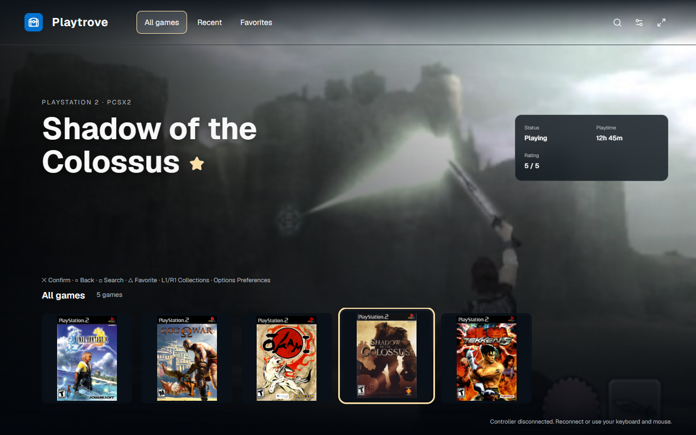
      <p align="center"><sub>Fullscreen library</sub></p>
    </td>
    <td width="50%">
      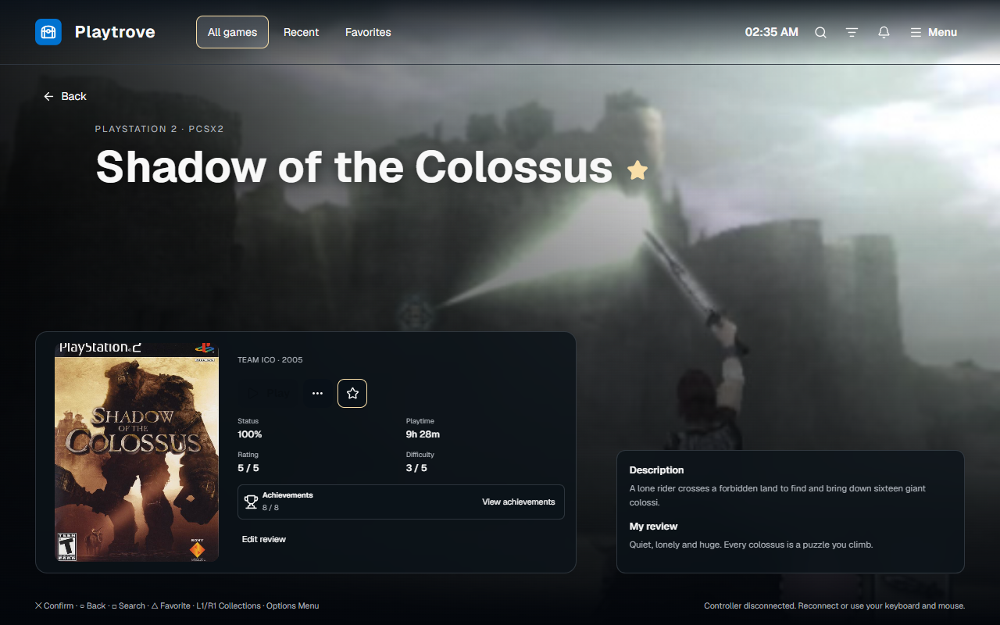
      <p align="center"><sub>Fullscreen Signature details</sub></p>
    </td>
  </tr>
  <tr>
    <td width="50%">
      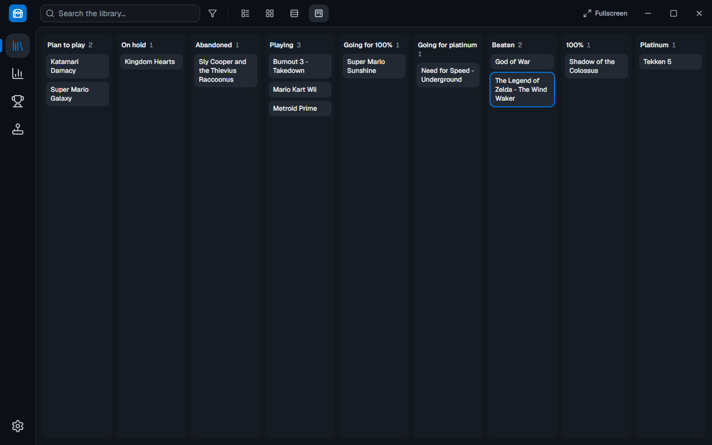
      <p align="center"><sub>Kanban view</sub></p>
    </td>
    <td width="50%">
      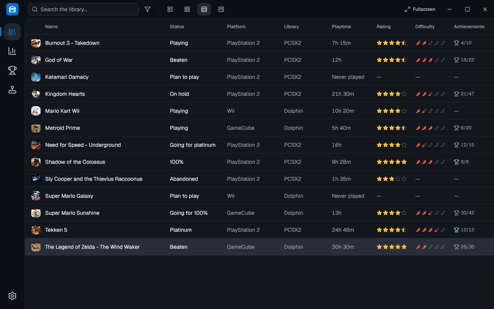
      <p align="center"><sub>List view</sub></p>
    </td>
  </tr>
  <tr>
    <td width="50%">
      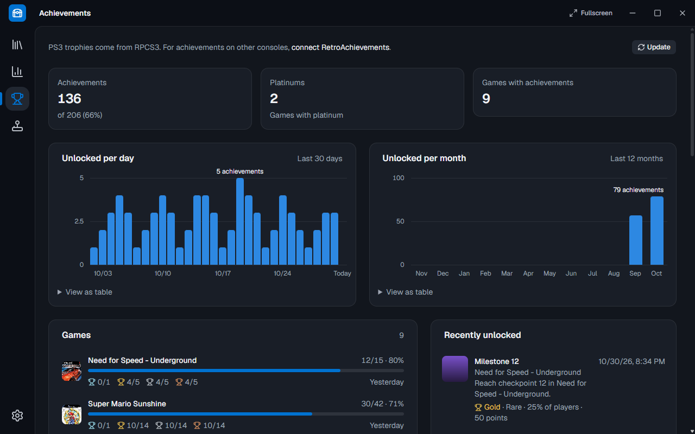
      <p align="center"><sub>Achievements and trophies</sub></p>
    </td>
    <td width="50%">
      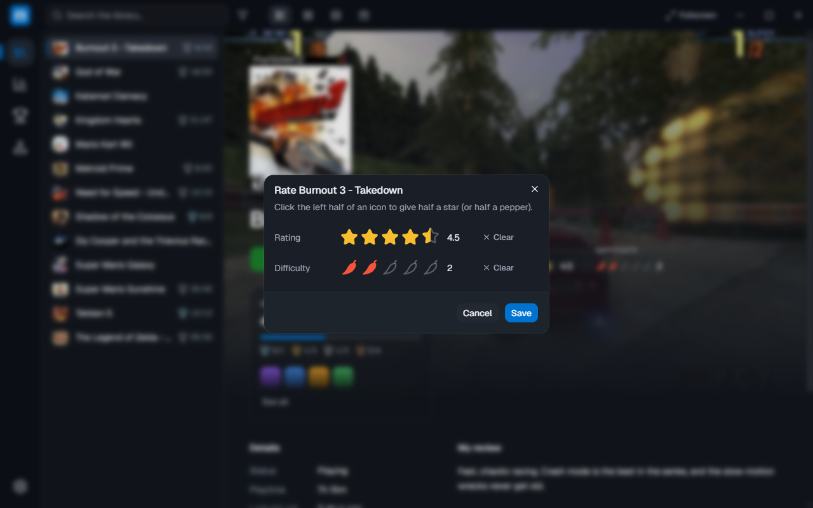
      <p align="center"><sub>Rating a game</sub></p>
    </td>
  </tr>
  <tr>
    <td width="50%">
      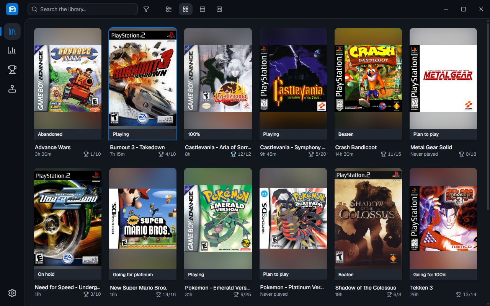
      <p align="center"><sub>Grid view</sub></p>
    </td>
    <td width="50%">
      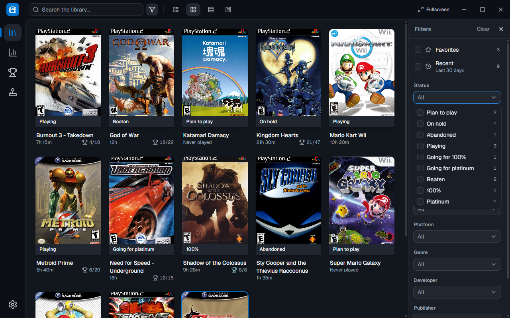
      <p align="center"><sub>Filter panel</sub></p>
    </td>
  </tr>
  <tr>
    <td width="50%">
      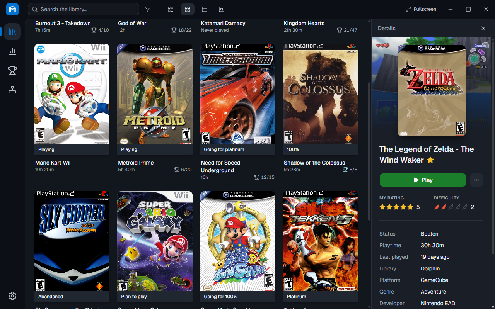
      <p align="center"><sub>Details panel in Grid view</sub></p>
    </td>
    <td width="50%">
      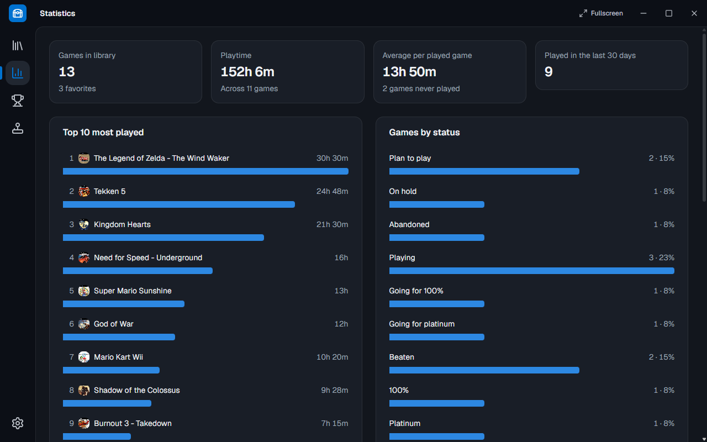
      <p align="center"><sub>Statistics</sub></p>
    </td>
  </tr>
  <tr>
    <td width="50%">
      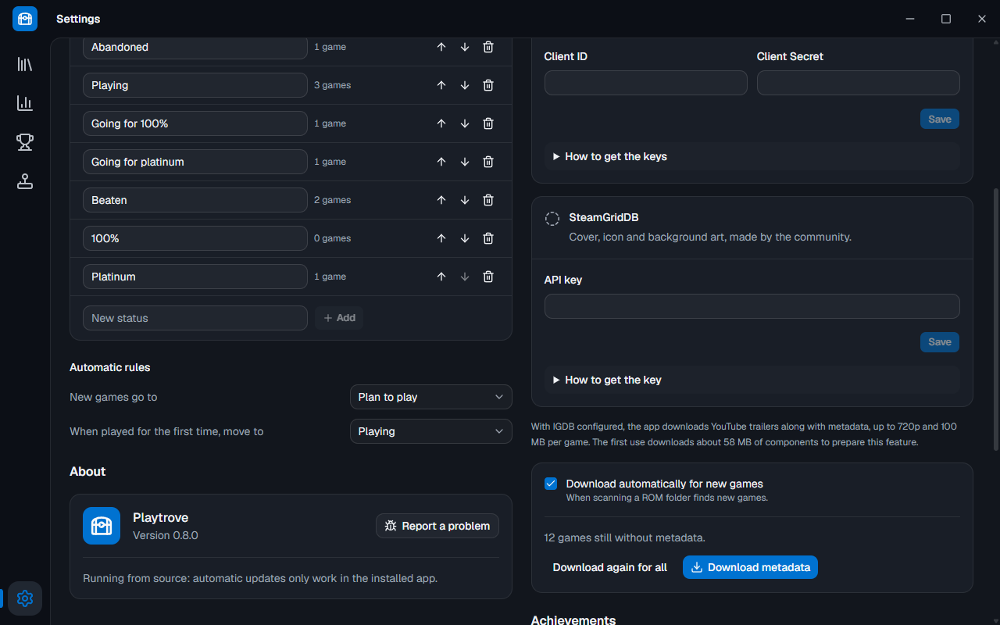
      <p align="center"><sub>Metadata and images</sub></p>
    </td>
    <td width="50%">
      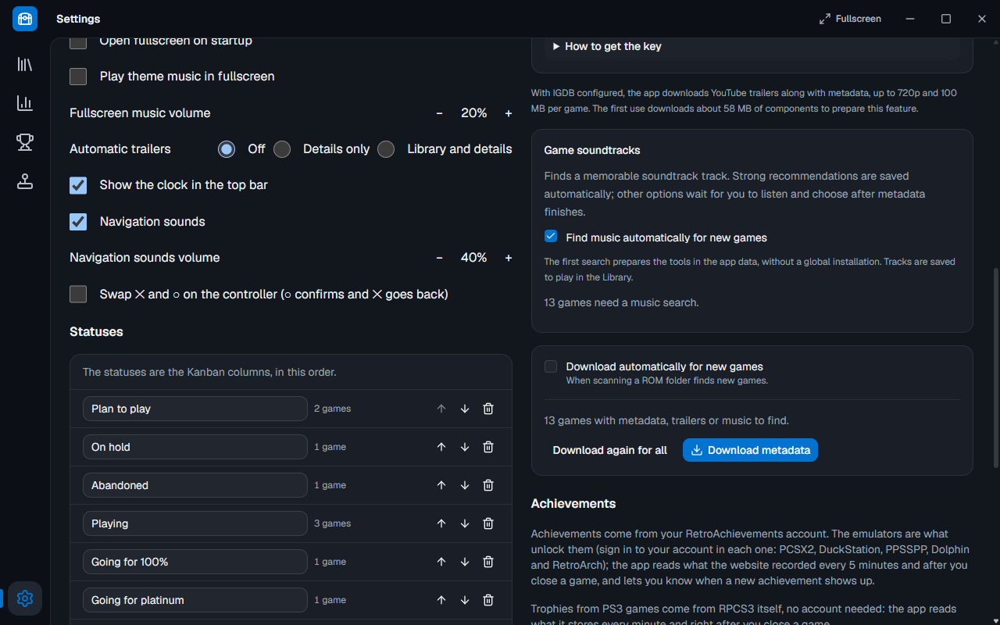
      <p align="center"><sub>Settings → Statuses</sub></p>
    </td>
  </tr>
  <tr>
    <td width="50%">
      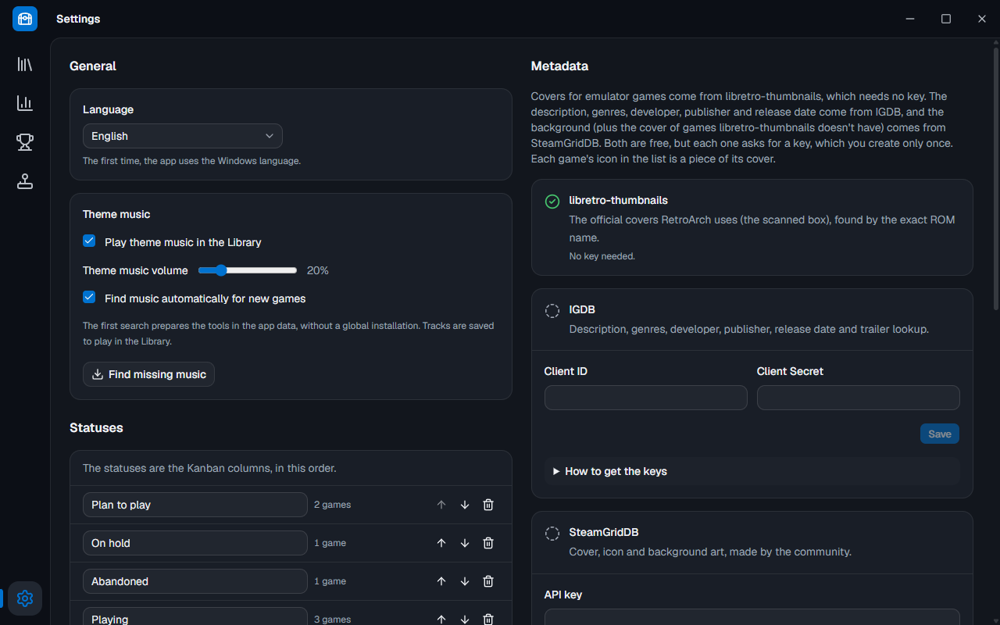
      <p align="center"><sub>Theme music settings</sub></p>
    </td>
    <td width="50%">
      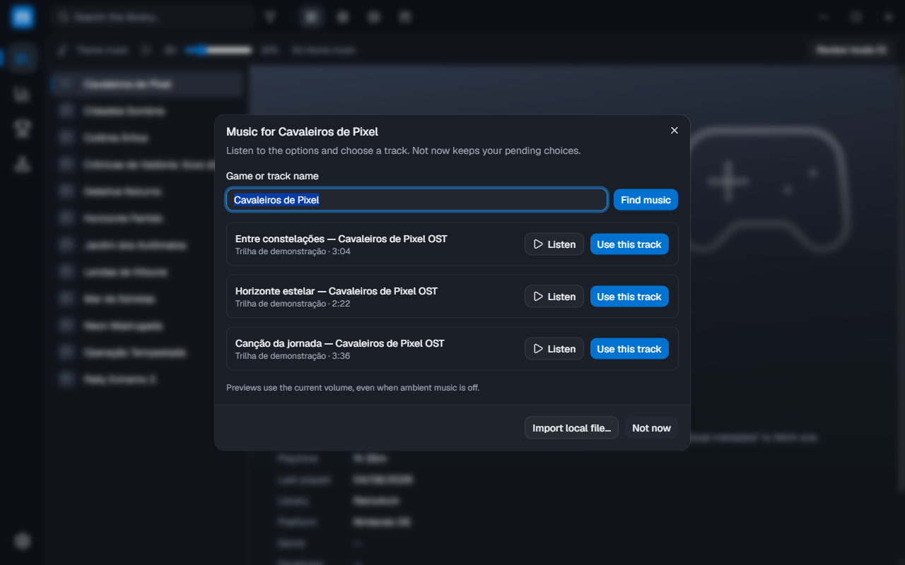
      <p align="center"><sub>Listen and choose a soundtrack</sub></p>
    </td>
  </tr>
</table>

## Download

Get the latest version from the [Releases](https://github.com/LamarcKz/Playtrove/releases/latest) page:

- **`Playtrove-Setup-X.Y.Z.exe`**: the installer. It installs just for you, without asking for admin rights, with shortcuts in the Start menu and on the desktop. When a new version comes out, the app lets you know and updates with one click.
- **`Playtrove-X.Y.Z-portable.zip`**: the portable version. Unzip it anywhere and open `Playtrove.exe`: your library stays in the `data` folder next to it.

> [!NOTE]
> Playtrove isn't digitally signed yet, so Windows may show "Windows protected your PC" the first time. Click **More info** and then **Run anyway**.

Each version's changes are on the same page. Version numbers follow [Semantic Versioning](https://semver.org/) (`MAJOR.MINOR.PATCH`).

**Requirements:** Windows 10 or 11, 64-bit.

## Privacy

Playtrove doesn't collect anything about you. Your library, ratings and reviews stay in a database on your computer, and your API keys are encrypted by Windows. The app goes online to download game metadata and images (IGDB, SteamGridDB and libretro-thumbnails), trailers and theme music (YouTube) and their tools (official GitHub releases), to read your achievements (RetroAchievements, if you add your account) and to check GitHub for new versions (you can turn that off in Settings → About).

## Bugs and ideas

Found a bug? In the app, go to **Settings → About → Report a problem**: it opens the form on GitHub with your version already filled in. You can also [open an issue](https://github.com/LamarcKz/Playtrove/issues/new/choose) directly, in English or Portuguese. Ideas are welcome too. For security problems, see [SECURITY.md](SECURITY.md).

Pull requests are welcome; please run `npm test` before sending one. The code comments and the developer docs ([ESTRUTURA.md](ESTRUTURA.md)) are written in Portuguese.

## Build from source

You'll need [Node.js](https://nodejs.org/) 22.12 or newer, [Git](https://git-scm.com/) and [Rust](https://www.rust-lang.org/tools/install) (stable), which on Windows also asks for the Visual Studio Build Tools with the C++ workload. The first `npm run dev` compiles the Rust side, which takes a few minutes; after that, only what changed.

```bash
git clone https://github.com/LamarcKz/Playtrove.git
cd Playtrove
npm install
npm run dev
```

`git clone` gets the `main` branch, with the latest stable version. Development happens on the `desenvolvimento` branch: to try what's in progress, run `git switch desenvolvimento` before `npm install`.

| Command | What it does |
|---|---|
| `npm run dev` | Opens the app in development mode: the interface updates on every change, and the app restarts when the Rust code changes. It uses a copy of your installed library (`%APPDATA%\Playtrove Dev`), so code in progress never touches your real games |
| `npm run dev:nova-copia` | Throws that copy away (with the dev app closed); the next `npm run dev` copies your library again |
| `npm run build` | Checks the types and builds the interface into `out/web` |
| `npm run typecheck` | Only checks the TypeScript types |
| `npm test` | Runs all the automated tests: the interface logic, the Rust side and the ones that open the app and click around like a person |
| `npm run dist` | Builds the installer, the portable version and the update files into `dist/` (signing the updates needs the maintainers' private key) |

Want to understand the code? The guide to every folder and file, and where to build each new feature, is in [ESTRUTURA.md](ESTRUTURA.md) (in Portuguese).

## Roadmap

- Import games from Steam, GOG and PC game folders
- More emulators
- Edit a game's details and pick another cover
- Remember the view and the filters when the app opens again
- Customization options, like a light theme
- Links to each game's page

## Built with

- [Tauri](https://tauri.app/) and [Rust](https://www.rust-lang.org/), with the interface built by [Vite](https://vite.dev/)
- [React](https://react.dev/) and [TypeScript](https://www.typescriptlang.org/)
- [Tailwind CSS](https://tailwindcss.com/), [shadcn/ui](https://ui.shadcn.com/) and [Lucide](https://lucide.dev/) icons
- [SQLite](https://sqlite.org/) with [rusqlite](https://github.com/rusqlite/rusqlite)
- Tests with [Vitest](https://vitest.dev/), [Playwright](https://playwright.dev/) and Rust's own (`cargo test`)

## Credits

- The look is inspired by [Playnite](https://playnite.link/), an independent project with no connection to this one.
- The icons come from [Lucide](https://lucide.dev/) (ISC license).
- Game metadata comes from [IGDB](https://www.igdb.com/) (by Twitch); covers from [libretro-thumbnails](https://thumbnails.libretro.com/), the [RetroArch](https://www.retroarch.com/) community's collection; and background art (and any missing covers) from [SteamGridDB](https://www.steamgriddb.com/), made by its community.
- Trailer and theme music downloads use [yt-dlp](https://github.com/yt-dlp/yt-dlp) and [Deno](https://github.com/denoland/deno), downloaded from their official releases and verified before use.
- Achievements come from [RetroAchievements](https://retroachievements.org/), a community project with no connection to this one.
- Game, console and service names belong to their owners. PlayStation and DualSense are trademarks of Sony Interactive Entertainment; Playtrove isn't affiliated with Sony or with any of the services above.

## License

Playtrove is free software under the [MIT License](LICENSE).
